

  <a href="https://aiwithjen.com"><picture><source media="(prefers-color-scheme: dark)" srcset=".github/badges/header-dark.svg">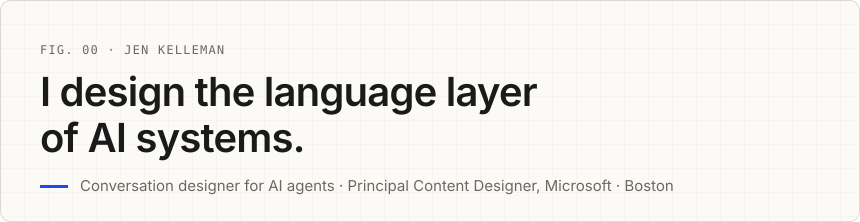</picture></a>

  <picture><source media="(prefers-color-scheme: dark)" srcset=".github/badges/tag-agent-supervision-dark.svg"></picture>
  <picture><source media="(prefers-color-scheme: dark)" srcset=".github/badges/tag-conversation-design-dark.svg"></picture>
  <picture><source media="(prefers-color-scheme: dark)" srcset=".github/badges/tag-content-as-code-dark.svg"></picture>
  <picture><source media="(prefers-color-scheme: dark)" srcset=".github/badges/tag-errors-recovery-dark.svg"></picture>
  <picture><source media="(prefers-color-scheme: dark)" srcset=".github/badges/tag-evals-dark.svg"></picture>
  <picture><source media="(prefers-color-scheme: dark)" srcset=".github/badges/tag-semantic-layers-dark.svg"></picture>

I'm a principal content designer at Microsoft, working on agent experiences in Microsoft Fabric. I design how agents report status, ask for approval, explain failures and hand work back to people. I've spent 14 years in UX, from voice experiences for AT&T, American Express, Bank of America and Verizon to autonomous data agents today. With a data science background (Carnegie Mellon), I prototype in code and work in the same repos as my engineering partners.

Portfolio: **[aiwithjen.com](https://aiwithjen.com)**

### Selected results

  <picture><source media="(prefers-color-scheme: dark)" srcset=".github/badges/result-1-dark.svg">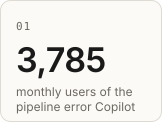</picture>
  <picture><source media="(prefers-color-scheme: dark)" srcset=".github/badges/result-2-dark.svg">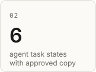</picture>
  <picture><source media="(prefers-color-scheme: dark)" srcset=".github/badges/result-3-dark.svg">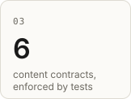</picture>
  <picture><source media="(prefers-color-scheme: dark)" srcset=".github/badges/result-4-dark.svg">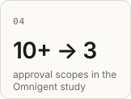</picture>
  <picture><source media="(prefers-color-scheme: dark)" srcset=".github/badges/result-5-dark.svg">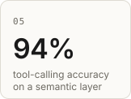</picture>

### Language as infrastructure

Illustrative patterns from my practice: what happened, what it affects and what the person can do next.

  <picture><source media="(prefers-color-scheme: dark)" srcset=".github/badges/rewrite-1-dark.svg">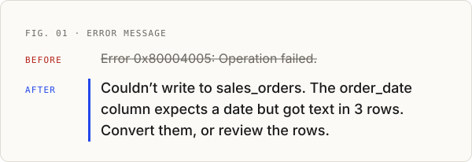</picture>
  <picture><source media="(prefers-color-scheme: dark)" srcset=".github/badges/rewrite-2-dark.svg">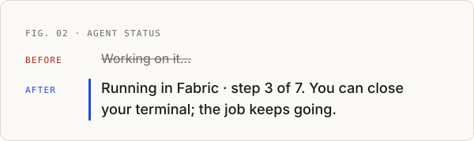</picture>
  <picture><source media="(prefers-color-scheme: dark)" srcset=".github/badges/rewrite-3-dark.svg">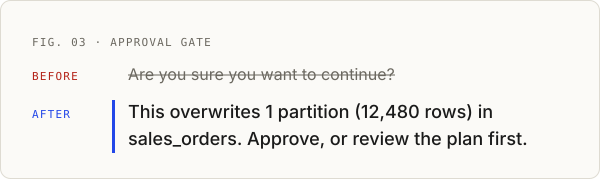</picture>

### Open-source work

  <a href="https://github.com/jkelleman/support-agent-pattern-library"><picture><source media="(prefers-color-scheme: dark)" srcset=".github/badges/project-support-agent-pattern-library-dark.svg">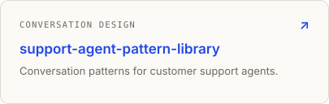</picture></a>
  <a href="https://github.com/jkelleman/multilingual-voice-guide"><picture><source media="(prefers-color-scheme: dark)" srcset=".github/badges/project-multilingual-voice-guide-dark.svg">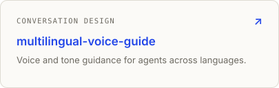</picture></a>
  <a href="https://github.com/jkelleman/omnigent-agent-session-patterns/tree/agent-session-patterns"><picture><source media="(prefers-color-scheme: dark)" srcset=".github/badges/project-omnigent-agent-session-patterns-dark.svg">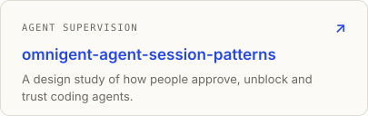</picture></a>
  <a href="https://github.com/jkelleman/fabric-agent-canvas"><picture><source media="(prefers-color-scheme: dark)" srcset=".github/badges/project-fabric-agent-canvas-dark.svg">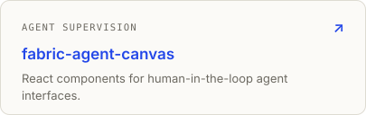</picture></a>
  <a href="https://github.com/jkelleman/golden-dataset-kit"><picture><source media="(prefers-color-scheme: dark)" srcset=".github/badges/project-golden-dataset-kit-dark.svg">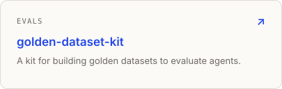</picture></a>
  <a href="https://github.com/jkelleman/lintel"><picture><source media="(prefers-color-scheme: dark)" srcset=".github/badges/project-lintel-dark.svg">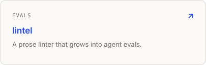</picture></a>
  <a href="https://github.com/jkelleman/prompt-ops-eval-harness"><picture><source media="(prefers-color-scheme: dark)" srcset=".github/badges/project-prompt-ops-eval-harness-dark.svg">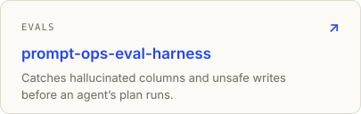</picture></a>
  <a href="https://github.com/jkelleman/semantic-metrics-modeling-assistant"><picture><source media="(prefers-color-scheme: dark)" srcset=".github/badges/project-semantic-metrics-modeling-assistant-dark.svg">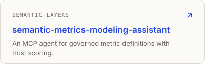</picture></a>
  <a href="https://github.com/jkelleman/ai-assisted-insights-agent"><picture><source media="(prefers-color-scheme: dark)" srcset=".github/badges/project-ai-assisted-insights-agent-dark.svg">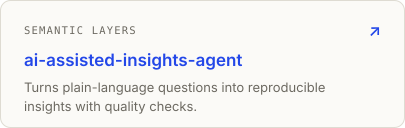</picture></a>

### Tools I use

Python · TypeScript · React · SQL · MCP · Git and GitHub · Figma · automated tests

### Get in touch

Building agents people need to trust? Let's talk.

[aiwithjen.com](https://aiwithjen.com) · [LinkedIn](https://linkedin.com/in/jenniferkelleman) · jennifer.kelleman@gmail.com
